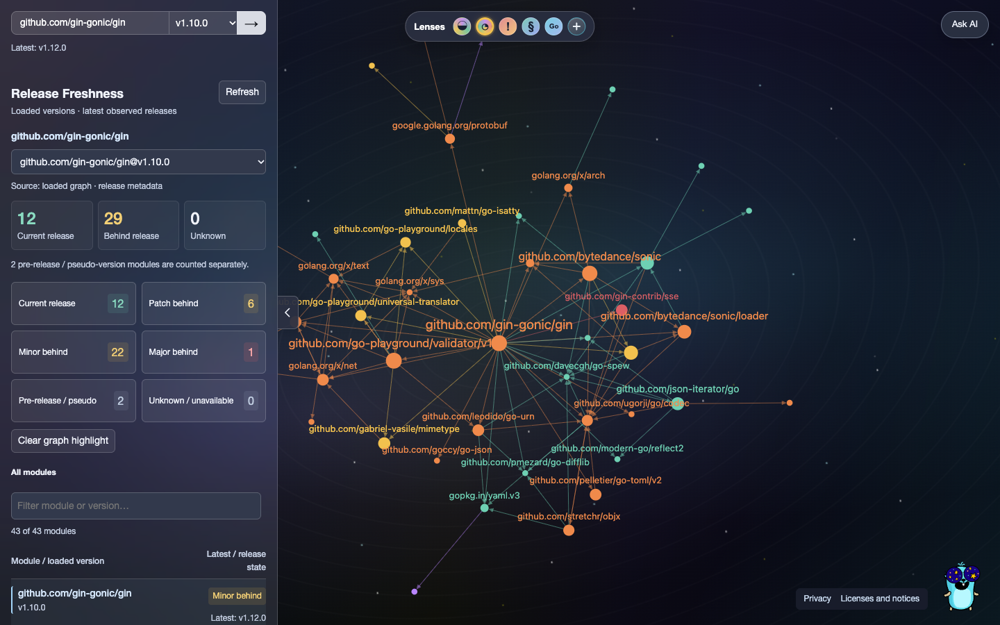
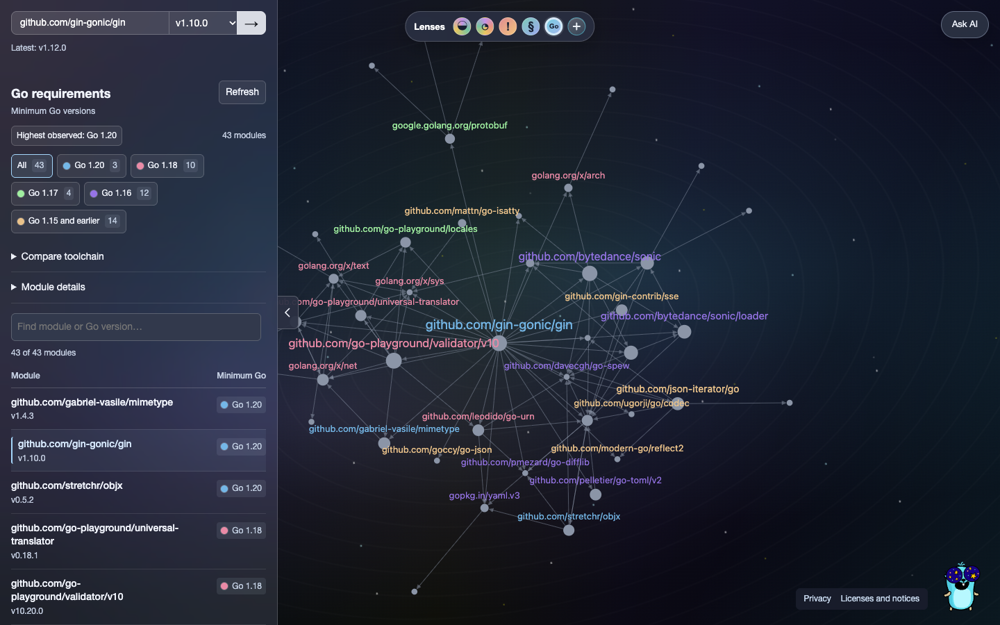

<p align="center">
  
</p>

`gomod-lens` explores public Go module dependency graphs in a browser. It runs as a static WebAssembly application and analyzes modules
through five browser lenses: OpenSSF Scorecard, Release Freshness,
Vulnerability exposure, License evidence and Go requirements.

Deployed to GitHub Pages: https://amer8.github.io/gomod-lens/

After a public module loads, the version selector shows the loaded version,
marks the latest version reported by the Go module proxy, and lets you switch
to older published versions. The search field keeps the module path; Analyze
preserves the selected version for that module. Explicit `module@version`
input and shared URLs still work.

**[Start the guided example: Gin v1.10.0](https://amer8.github.io/gomod-lens/?lens=release-freshness#target=github.com%2Fgin-gonic%2Fgin%40v1.10.0)**

## 1. Load a published version

Open [go.mod Lens](https://amer8.github.io/gomod-lens/) and enter:

```text
github.com/gin-gonic/gin@v1.10.0
```

The graph shows resolved module versions and their requirement relationships.
Use the version selector to load another published release. URLs preserve the
selected root version and lens, so another person can open the same view.



*The screenshot is an example observation. Release and repository data can
change after a module was published.*

## 2. Trace a dependency

Select a node, open **Go requirements**, and inspect **Module details**. For a
dependency with a recorded path, expand **Dependency path** and use
**Highlight path** to trace it back to the root.

Requirement edges describe module relationships. They do not identify package
imports or calls to a particular function.

## 3. Compare your Go toolchain

The Go requirements lens groups modules by their declared minimum Go version.
Open **Compare toolchain**, enter a version such as `1.26.0`, and choose
**Compare**. Modules whose observed minimum exceeds the target are marked
**Requires newer**. Changing the target compares the existing observations
locally without another lookup.



Select a version group to filter and highlight its modules. **Highest observed**
focuses the greatest recorded minimum. Gray means that metadata is unknown.
An older minimum alone does not indicate poor maintenance or insecurity.

Read the [Go requirements guide](docs/features/go-requirements.md) for patch,
prerelease, replacement, and Refresh behavior.

## 4. Inspect the other evidence

| Investigation | Lens | What the observation means |
| --- | --- | --- |
| Compare loaded and published releases | Release Freshness | A release gap does not establish upgrade compatibility |
| Inspect known advisory matches | Vulnerability exposure | OSV matches an exact module version; function reachability is unassessed |
| Review recorded license expressions | License evidence | Expressions come from metadata and do not establish license compatibility |
| Inspect repository security-practice checks | OpenSSF Scorecard | The report assesses a repository snapshot that may postdate the module release |

Keep unknown and failed lookups separate from successful observations. A failed
request cannot establish that no advisories or license expressions exist.

For each lens's controls and source details, see [analysis views](docs/features/analysis-views.md),
[vulnerability exposure](docs/features/vulnerability-exposure.md),
[license evidence](docs/features/license-evidence.md), and
[Scorecard details](docs/features/scorecard-details.md).

## 5. Ask a follow-up

Choose **Ask AI** and load a local model to ask about the graph. For example:

- “How is the selected module connected to the root?”
- “Which modules have known advisory matches?”
- “What license evidence is available?”

The assistant can select or highlight modules and show supporting evidence.
Chat requires WebGPU and a downloaded model. Inference stays on your device;
evidence lookups still use public services. See the
[assistant guide](docs/features/graph-assistant.md).

## Continue with another module

Load another root or version to start a new analysis context. Try
`github.com/spf13/cobra` or `github.com/google/uuid@v1.6.0`, choose a dependency,
and repeat the investigations that matter to you.

## Run the tour locally

From a checkout, with Go 1.26+ installed:

```sh
make serve
```

Open [localhost:4173](http://localhost:4173). The Go server serves the static
application; Go/WASM performs analysis in your browser. Public upstream services
are still required. Use Node.js 24 LTS to run `make check`.

For changes to the application, see [Contributing](CONTRIBUTING.md) and the
[lens developer guide](docs/development/lenses.md).

## Public data and licensing

Use public module identifiers. See [Privacy](PRIVACY.md) for external requests,
local model behavior, and caching.

Project code is [MIT licensed](LICENSE). See [third-party notices](THIRD_PARTY_NOTICES.md)
for data and model terms, browser libraries, and the CC0 gopher artwork by
[MariaLetta](https://github.com/MariaLetta/free-gophers-pack).
