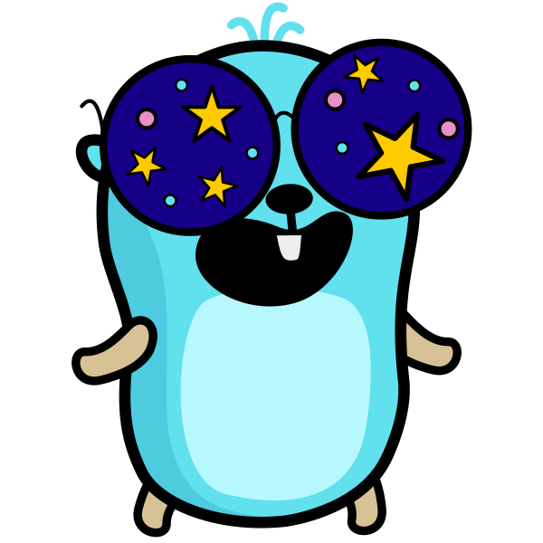

  

`gomod-lens` explores public Go module dependency graphs in a browser. It can
run as a Go web server or as a static WebAssembly build, and analyzes modules
through four browser lenses: OpenSSF Scorecard, Release Freshness,
Vulnerability exposure and License evidence.

Deployed to GitHub Pages: https://amer8.github.io/gomod-lens/

After a public module loads, the version selector shows the loaded version,
marks the latest version reported by the Go module proxy, and lets you switch
to older published versions. The search field keeps the module path; Analyze
preserves the selected version for that module. Explicit `module@version`
input and shared URLs still work. This is available in both the Go web UI
and the static WebAssembly build.

## Lenses

OpenSSF Scorecard highlights repository security practices. Release Freshness
shows whether selected versions are current, patch/minor/major behind,
pre-release, pseudo-version, or unknown. Vulnerability exposure matches exact
module versions against OSV advisories. License evidence displays expressions
observed by deps.dev for exact module versions.

Go graph enrichment supplies Scorecard summaries and release freshness in the
graph payload. The browser adds Scorecard check details, vulnerability matches
and license evidence when those views are opened. These browser observations
are not included in `/api/graph`. Both layers can be extended; see the
[lens developer guide](docs/development/lenses.md).

The **Graph assistant** adds a collapsible chat dock with three contextual
starter questions and three follow-ups after each answer. It connects answers
to module selections, graph highlights, and source evidence. Chat requires
WebLLM and a loaded model. A searchable, sortable comparison table offers ten curated browser-friendly models with download and memory estimates. Supported models think automatically; switch the
loaded model while retaining chat history. Custom questions receive streamed answers using
module evidence and conversation context, including source repository links. See [the assistant guide](docs/features/graph-assistant.md) for its
scope, model download, privacy, and reproduction steps.

## Scorecard details

The Scorecard lens shows the selected module’s source repository report with
individual check scores, explanations, evidence, assessed commit, date and
Scorecard version. Choose a graph node or the module selector to inspect it.
Filter checks by name or availability and expand a check for remediation links.
Unknown checks remain unknown. Reports describe a repository snapshot and may
postdate the selected module release.

## Development

The four browser lenses use Repository on graph (Scorecard), Update queues
(Freshness), Result groups (vulnerabilities), and Evidence inventory (licenses).
They work in both the Go web UI and static WASM build. See the
[analysis views and reproduction steps](docs/features/analysis-views.md).

Run `make help` for the full target list.

Development requires Go 1.26+ and Node.js 22+ for tests, without an npm build.
`make check` runs Go/WASM checks and the browser logic and asset parity tests.

See [CONTRIBUTING.md](CONTRIBUTING.md) for development notes.

## Privacy

Treat go.mod Lens as a public-module explorer. Do not submit private module
paths, repository names, tokens, or other secrets to a public deployment.
External service behavior is summarized in [PRIVACY.md](PRIVACY.md).

## Credits

Mascot artwork uses
[63.svg](https://github.com/MariaLetta/free-gophers-pack/blob/master/characters/svg/63.svg)
from [MariaLetta/free-gophers-pack](https://github.com/MariaLetta/free-gophers-pack),
licensed under CC0 1.0 Universal.

## License

go.mod Lens is released under the MIT License. See [LICENSE](LICENSE).

Third-party notices are in [THIRD_PARTY_NOTICES.md](THIRD_PARTY_NOTICES.md).
