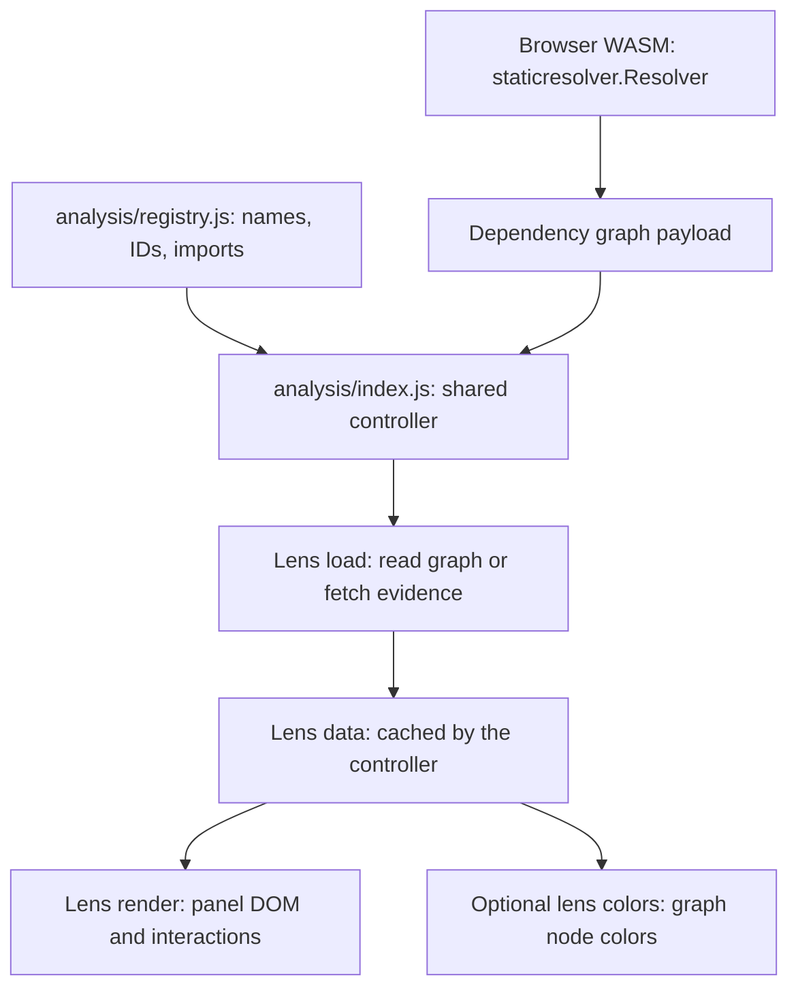

# Contributing lenses

Start with the task you want to do:

| Your change | Start here |
| --- | --- |
| Change an existing lens's data or panel | [Existing-lens map and edit recipe](#change-an-existing-lens) |
| Add a toolbar lens | [Scaffold a working browser view](#add-a-lens) |
| Include analysis in the WASM graph payload | [Add Go graph enrichment](#add-go-graph-enrichment) |
| Understand loading, selection or Refresh | [Browser contract and lifecycle](#browser-contract) |
| A change does not appear or a check fails | [Troubleshooting](#troubleshooting) |

## How the pieces fit

A browser lens is an object with two main hooks: **`load` produces data;
`render` displays it**. Register that object once in `registry.js`. The shared
controller creates its panel and handles loading, cancellation, caching,
selection, Refresh and toolbar navigation.



| Extension | Where its result lives | Current examples |
| --- | --- | --- |
| Browser view, JavaScript | Browser memory; a panel and optional graph colors | All five toolbar lenses |
| Graph enrichment, Go | `node.lenses[id]` in the WASM graph payload | Scorecard summary and release freshness |

A browser view reads graph fields or fetches public evidence in the static app. Add Go enrichment when the result also needs
to be part of the graph payload.

### Source ownership

Author browser lens code in **`internal/app/web/static/analysis/`**. The static
app is generated into ignored `dist/` by `make wasm`, including every browser
asset and the plain HTML shell in `internal/app/web/index.html`. The build replaces the asset tree, so deleted
sources disappear from the output. No manual copying or synchronization is needed.

Paths below are relative to the repository root; `analysis/` abbreviates
`internal/app/web/static/analysis/`.

| File/directory | Responsibility |
| --- | --- |
| `analysis/registry.js` | Browser IDs, state keys, labels, descriptions, glyphs and imports |
| `analysis/types.js` | Browser lens contract |
| `analysis/index.js` | Shared lifecycle; usually unchanged when adding or modifying a lens |
| `analysis/public-data.js` | Public JSON/text fetching, resolved identities and bounded module lookups |
| `analysis/ui.js` | Shared DOM, tables, search, badges and disclosures |
| `analysis/analysis.css` | Shared and lens-specific panel styles |
| `analysis/navigation.js` | URL handling derived from the registry |
| `internal/app/web/static/app-controller.js` | Shared navigation, suggestions and request lifecycle |
| `internal/app/web/static/wasm-client.js` | WASM graph and module search loading |
| `internal/app/web/static/graph.js` | Graph rendering and application of lens colors |
| `internal/app/web/static/graph-traversal.js` | Shared directed paths, reachability and dependency counts |
| `internal/graph/lens.go` and `model.go` | Go lens metadata, result helpers and serialized types |
| `internal/staticresolver/` | WASM graph resolution and enrichment |
| `internal/modulesearch/` | Module search queries, repository filtering and result ranking |
| `internal/graphview/` | Go sidebar summary groups |
| `tools/lenses.mjs` | Browser lens scaffolding and registration |

## Change an existing lens

Find the implementation you need before changing the controller:

| Toolbar lens (`id` → state `key`) | Browser implementation and data entry points | Go graph data | Focused browser tests |
| --- | --- | --- | --- |
| Scorecard (`openssf` → `scorecard`) | `analysis/scorecard.js`: `loadReport`, `normalizeReport`, `render` | `internal/graph/openssf_project.go`; `internal/staticresolver/openssf.go` | `tests/scorecard-details.test.mjs` |
| Freshness (`release-freshness` → `freshness`) | `analysis/freshness.js`: `readFreshness`, `freshnessRecord`, `render` | `internal/graph/release_freshness.go`; `internal/staticresolver/release_freshness.go` | `tests/analysis-views.test.mjs` |
| Vulnerabilities (`vulnerabilities` → `vulnerabilities`) | `analysis/vulnerabilities.js`: `lookupVulnerabilities`, `groupAdvisories`, `render` | No Go enrichment; OSV observations stay in the browser | `tests/vulnerability-exposure.test.mjs` |
| Licenses (`licenses` → `licenses`) | `analysis/licenses.js`: `lookupLicenses`, `licenseObservation`, `licenseColors`, `render` | No Go enrichment; deps.dev observations stay in the browser | `tests/license-evidence.test.mjs` |
| Go requirements (`go-requirements` → `go-requirements`) | `analysis/go-requirements.js`: panel; `go-requirements-data.js`: `lookupGoRequirements`, `requirementColors` | `staticresolver/gomod.go` shares the Go module parser; `go_requirements.go` loads missing exact versions through WASM | `tests/go-requirements.test.mjs`; `internal/staticresolver/go_requirements_test.go` |

An `id` is used in `?lens=...`, panel attributes and graph lens results.
A `key` identifies the controller's state and data cache. Keep existing values
stable; for a new lens, using the same string for both is simplest.

| What you want to change | Files/hooks to edit |
| --- | --- |
| Label, tooltip, heading, capability description or icon | Its entry in `registry.js` |
| Panel content or filters | Its `render` function; retain user choices in `state` |
| Interpretation of source data | Its exported normalization/data functions and relevant data tests |
| Graph node colors | Its `colors` function; keep missing/failed observations unknown |
| Lens styles | `analysis.css`; toolbar styling uses `.lens-circle-<id>` |

For a typical browser change:

```sh
# Edit the lens module and its relevant tests, then:
make wasm
node --test tests/license-evidence.test.mjs  # Substitute the relevant test file.
make test-js                              # Includes registration and tooling.
```

Run `make serve` to rebuild and preview the static app. Verify the change in
the browser before opening a PR.

### Example: License evidence

Trace `licenses.js` for a complete browser-only inventory:

1. Its default export connects `load: lookupLicenses`, `render`, and
   `colors: licenseColors`. `modulePicker: true` reuses one graph-wide result.
2. `lookupLicenses` uses `publicIdentity`, `mapModules` and `publicJSON` to fetch
   resolved-version evidence, then normalizes it with `licenseObservation`.
3. The returned `{records, capturedAt}` uses a `Map` keyed by **graph node ID**.
   `render` displays those records; `licenseColors` colors the same IDs.
4. `tests/license-evidence.test.mjs` covers normalization, replacements and
   lookup failures without a browser.

## Add a lens

```sh
make new-lens NAME=module-overview
make test-js
make serve
```

Open <http://localhost:4173/?lens=module-overview#target=github.com%2Fspf13%2Fcobra>.
The command creates a working graph summary in `analysis/module-overview.js`,
registers it and adds `tests/module-overview.test.mjs`. Run `make serve` to
copy the new sources into the static deployment. The starter makes no external requests.

Adapt the starter in this order:

1. Replace `summarizeGraph` with the analysis and add tests for its meaningful
   outcomes. Keep normalization separate from DOM rendering so Node can test it.
2. Choose the loading scope: leave the default for graph-wide analysis, use
   `modulePicker: true` for a graph inventory with selected-module details, or
   `selection: true` for a lookup that must load/cache per selected module.
3. Replace the metrics in `render`. Use `ui.js` controls and the supplied
   `state`, `select` and `highlight`; handle the `{error}` load result.
4. Add `colors` if the analysis needs its own graph colors. Add view-specific
   styles to `analysis.css` and adjust the registry's title/description/icon.
5. Add reproduction steps under `docs/features/` and follow
   [validation](#validation). For external services, reuse `public-data.js` and
   document requests in `PRIVACY.md` and `THIRD_PARTY_NOTICES.md`.

You can also register a hand-written module by adding an entry to
`browserLenses`. `importModule` must return a module whose default export is a
`BrowserLens`. Registration does not require changing `index.js`,
`navigation.js`, the application entrypoint, or the HTML shell.

### Does a new lens need assistant changes?

The registry's `label` and `description` supply app guidance. To add answers
that interpret the lens's results, extend `assistant/queries.js`,
`assistant/suggestions.js` and `assistant/custom.js` and their tests. Rebuild the
static deployment with `make wasm` after editing canonical sources.

## Browser contract

Each implementation exports a default object described by `BrowserLens` in
`types.js`. Registration metadata belongs only in `registry.js`.

| Property | Required | Meaning |
| --- | --- | --- |
| `scope` | Yes | Short description beneath the panel heading |
| `load(graph, context)` | Yes | Async data loading; return lens-specific data |
| `render(context)` | Yes | Synchronous DOM rendering into the supplied empty `host` |
| `selection` | No | Load/cache per selected node; also show the module picker |
| `modulePicker` | No | Show the picker while retaining one result for the whole graph |
| `colors(graph, data, selectedID, state)` | No | Return node-ID to CSS-color mappings, optionally using lens-owned UI state |
| `status(data)` | No | Return a short source/status caption |

The load context supplies `node`, `signal` and `progress(done, total)`. Propagate
the signal into upstream requests. The render context supplies `host`, `graph`,
the currently selected `node`, `data`, `state`, and these callbacks:

- `select(nodeID)` selects a module and rerenders the active lens.
- `highlight({ids, nodesOnly, color})` highlights graph nodes. An empty `ids`
  array clears the explicit highlight. The graph renderer treats a single ID
  as a node selection unless `nodesOnly` is true.
- `repaint()` reapplies the active lens's colors after an input changes `state`.
  Use it when UI state affects color mappings; it does not reload data or
  recreate the panel.

The controller converts a thrown load error into `{error: message}`. Both
`render` and optional `status`/`colors` callbacks must handle that shape. A
module-level lookup failure should remain unknown, without discarding other
successful module results. An empty successful lookup is a separate outcome.

### Lifecycle and ownership

`analysis/index.js` owns the toolbar, lens panels, lens selection, lens URL and
built-in graph coloring. It creates the toolbar once and builds panels directly
for each graph. The sidebar renderer supplies summary groups and distributions.

Modules are imported independently when their view first opens or the assistant
requests their evidence. An import failure shows an error in that lens's panel;
Refresh retries the import, while other lenses remain usable. A pending import
does not delay other panels. Keep DOM work and network requests out of module
initialization. The controller calls `load` when a view opens; the assistant may
also request its data as evidence. Results
are reused per graph, or per node with `selection: true`; selecting a module in
an inventory rerenders without fetching the whole inventory again.

`render` receives a cleared host and must recreate its DOM. Keep filters and
expanded sections in the supplied `state`, rather than retaining detached DOM.
State survives node and lens selection within a graph. New root modules or
versions clear state/results and abort previous requests; generation checks
prevent superseded completions from updating the new graph. Avoid global event
listeners inside `render`, since it runs repeatedly.

Refresh clears the shared public fetch cache and reloads the active result
(the current node for a selection-scoped view). Freshness has no browser fetch:
its Refresh rereads metadata already present in the graph. It does not trigger
a fresh Go module mirror lookup or bypass the IndexedDB upstream cache.

Go requirements reuses each node's `goRequirement` observation when its resolved
identity matches. Missing exact versions use `gomodLensLoadGoRequirements` and
the same Go parser as graph resolution. Supplemental observations are cached
per graph without mutating its nodes. The load context's `refresh` flag forces
all public identities to reload and bypasses IndexedDB for that request.
Local replacements remain unknown. `descendantCount` is computed once in Go
and shared by sidebar groups and renderer sizing; JavaScript traversal remains
a fallback for legacy payloads and synthetic fixtures.

`publicJSON` and `publicText` provide a five-minute memory cache, 20-second
request timeout and credential-free requests. Use `publicText` for `.mod`
files. `mapModules` limits module lookups to four concurrent tasks and records
individual failures as unknown. `publicIdentity` resolves public replacements
and rejects missing/local replacement versions. Preserve source URLs and
observation times.

Views must not mutate the shared graph. Without a `colors` callback, the
renderer retains its built-in Scorecard/Freshness coloring. Use `textContent`
or the shared `element` helper for upstream text, and the shared HTTPS `link`
helper for source links.

## Add Go graph enrichment

Use this path when results belong in the initial graph payload.

1. Implement enrichment in `internal/staticresolver` using its `Fetcher` and
   invoke it from `Resolver.ResolveGraph`. Production fetching is supplied by
   the WASM bridge; tests use offline fixtures.
2. Define lens metadata in `internal/graph` and attach per-node results through
   `Node.SetLensResult`. Preserve node identities and keep failed lookups as
   unknown/error outcomes. There is one enrichment path to maintain.
3. Add focused fixture tests in `internal/staticresolver`. Keep Go toolchain
   reference tests for changes to module resolution.
4. Register a browser view if a panel is needed. Extend `internal/graphview`
   only when sidebar summary groups also need to change; return them by lens ID
   in `viewModel.lensGroups`. Presentation belongs to the browser registry.

For a concrete starting point, trace `applyReleaseFreshnessLens` in
`internal/staticresolver/release_freshness.go` and classification/result helpers
in `internal/graph/release_freshness.go`. Then read `freshnessRecord` in
`analysis/freshness.js` to see the browser consume that payload. Scorecard
follows the same pattern and fetches repository check details in its browser view.

Per-node Scorecard summaries live only in `node.lenses.openssf`. Read `status`
and the optional `score` from that result; `details` preserves the assessed
`module`, `version`, `projectId` and `date`. The assessed identity may differ
from the node when a dependency is replaced. Lookup errors and skip reasons
use `message`. Available lenses are declared in `meta.lenses`. The browser
loads the richer repository report, including individual checks, separately.

## Validation

```sh
make wasm        # Rebuild the deployment from canonical sources.
make test-js     # Data, registry, URLs and tooling.
make check       # Also Go formatting/modules, WASM build, vet and Go tests.
make serve       # Static preview: http://localhost:4173.
```

Use the [feature reproduction steps](../features/analysis-views.md) in the static app
to check selection, filters, unknown data, graph colors and
responsive layout. Automated checks do not replace manual UI checks.

## Troubleshooting

| Symptom | Check |
| --- | --- |
| New lens does not appear | Load a graph first; verify its `registry.js` entry/import. Rebuild with `make wasm` after source changes. |
| `?lens=...` selects Scorecard instead | Use the registry `id`, not its state `key`; unknown IDs fall back to Scorecard. |
| Change does not appear in the preview or Pages | Run `make wasm`, then reload the static page. |
| Filters disappear on node selection | Store filter values in `state`; `render` receives an empty host each time. |
| Changing a module reloads the whole inventory | Use `modulePicker: true` for a graph-wide inventory; `selection: true` is for per-node fetching. |
| An old lookup paints a new graph | Pass `signal` into every request and leave request ownership to the controller. |
| Unavailable results look successful | Distinguish missing/failed records from successful empty observations in normalization and colors. |
| A new external lookup fails in the browser | Check browser CORS support; browser evidence requests must work directly from the app's origin. |
