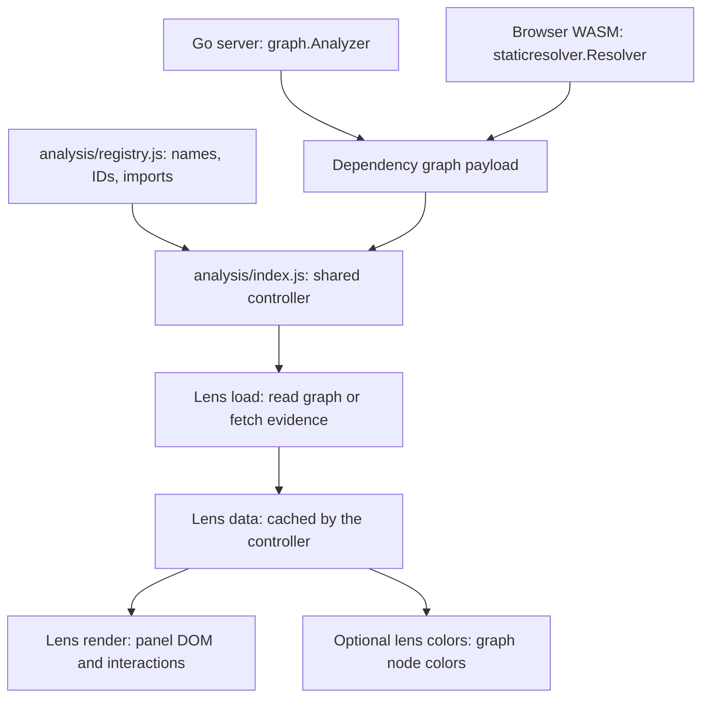

# Contributing lenses

Start with the task you want to do:

| Your change | Start here |
| --- | --- |
| Change an existing lens's data or panel | [Existing-lens map and edit recipe](#change-an-existing-lens) |
| Add a toolbar lens | [Scaffold a working browser view](#add-a-lens) |
| Include analysis in `/api/graph` | [Add Go graph enrichment](#add-go-graph-enrichment) |
| Understand loading, selection or Refresh | [Browser contract and lifecycle](#browser-contract) |
| A change does not appear or a check fails | [Troubleshooting](#troubleshooting) |

## How the pieces fit

A browser lens is an object with two main hooks: **`load` produces data;
`render` displays it**. Register that object once in `registry.js`. The shared
controller creates its panel and handles loading, cancellation, caching,
selection, Refresh and toolbar navigation.



| Extension | Where its result lives | Current examples |
| --- | --- | --- |
| Browser view, JavaScript | Browser memory; a panel and optional graph colors | All five toolbar lenses |
| Graph enrichment, Go | `node.lenses[id]` in the serialized graph, including `/api/graph` | Scorecard summary and release freshness |

A browser view works in both the Go web UI and static WASM UI. It can read graph
fields or fetch public evidence. Add Go enrichment when the result also needs
to be part of the graph payload.

### Source ownership

Author browser lens code in **`internal/app/web/static/analysis/`**. The static
app ships committed copies under `dist/assets/analysis/`; run `make sync-lenses`
after editing. It covers this directory, including helpers and CSS. Other
shared assets must be mirrored separately. The WASM build does not synchronize
these sources; parity tests detect drift. Delete obsolete files in both places.

Paths below are relative to the repository root; `analysis/` abbreviates
`internal/app/web/static/analysis/`.

| File/directory | Responsibility |
| --- | --- |
| `analysis/registry.js` | Browser IDs, state keys, labels, descriptions, glyphs and imports |
| `analysis/types.js` | Browser lens contract |
| `analysis/index.js` | Shared lifecycle; usually unchanged when adding or modifying a lens |
| `analysis/public-data.js` | Public JSON/text fetching, resolved identities and bounded module lookups |
| `analysis/ui.js` | Shared DOM, tables, search, badges and disclosures |
| `analysis/analysis.css` | Shared and lens-specific panel styles |
| `analysis/navigation.js` | URL handling derived from the registry |
| `internal/app/web/static/graph.js` | Graph rendering and application of lens colors |
| `internal/graph/lens.go` and `model.go` | Go enrichment interface and serialized result types |
| `internal/graph/analyzer.go` | Server enrichment registration |
| `internal/staticresolver/` | WASM graph resolution and enrichment |
| `internal/graphview/` | Go summary groups used by both deployments |
| `tools/lenses.mjs` | Scaffolding and browser lens asset synchronization |

## Change an existing lens

Find the implementation you need before changing the controller:

| Toolbar lens (`id` → state `key`) | Browser implementation and data entry points | Go graph data | Focused browser tests |
| --- | --- | --- | --- |
| Scorecard (`openssf` → `scorecard`) | `analysis/scorecard.js`: `loadReport`, `normalizeReport`, `render` | `internal/graph/openssf.go`, `openssf_project.go`; `internal/staticresolver/openssf.go` | `tests/scorecard-details.test.mjs` |
| Freshness (`release-freshness` → `freshness`) | `analysis/freshness.js`: `readFreshness`, `freshnessRecord`, `render` | `internal/graph/release_freshness.go`, `release_freshness_http.go`; `internal/staticresolver/release_freshness.go` | `tests/analysis-views.test.mjs` |
| Vulnerabilities (`vulnerabilities` → `vulnerabilities`) | `analysis/vulnerabilities.js`: `lookupVulnerabilities`, `groupAdvisories`, `render` | No Go enrichment; OSV observations stay in the browser | `tests/vulnerability-exposure.test.mjs` |
| Licenses (`licenses` → `licenses`) | `analysis/licenses.js`: `lookupLicenses`, `licenseObservation`, `licenseColors`, `render` | No Go enrichment; deps.dev observations stay in the browser | `tests/license-evidence.test.mjs` |
| Go requirements (`go-requirements` → `go-requirements`) | `analysis/go-requirements.js`: panel; `go-requirements-data.js`: `readGoMinimum`, `lookupGoRequirements`, `requirementColors` | No Go enrichment; reads exact-version `.mod` files in the browser | `tests/go-requirements.test.mjs` |

An `id` is used in `?lens=...`, panel attributes and graph lens results.
A `key` identifies the controller's state and data cache. Keep existing values
stable; for a new lens, using the same string for both is simplest.

| What you want to change | Files/hooks to edit |
| --- | --- |
| Label, tooltip, heading, capability description or icon | Its entry in `registry.js` |
| Panel content or filters | Its `render` function; retain user choices in `state` |
| Interpretation of source data | Its exported normalization/data functions and relevant data tests |
| Graph node colors | Its `colors` function; keep missing/failed observations unknown |
| Lens styles | `analysis.css`; toolbar styling uses `.lens-circle-<id>` |

For a typical browser change:

```sh
# Edit the lens module and its relevant tests, then:
make sync-lenses
node --test tests/license-evidence.test.mjs  # Substitute the relevant test file.
make test-js                              # Includes registration and parity.
```

Restart `make run` to reload Go-embedded JavaScript/CSS. For the static app,
reload after syncing; rebuild WASM only when Go code changes or the WASM
artifact has not been built yet. Verify the change in both deployments before
opening a PR.

### Example: License evidence

Trace `licenses.js` for a complete browser-only inventory:

1. Its default export connects `load: lookupLicenses`, `render`, and
   `colors: licenseColors`. `modulePicker: true` reuses one graph-wide result.
2. `lookupLicenses` uses `publicIdentity`, `mapModules` and `publicJSON` to fetch
   resolved-version evidence, then normalizes it with `licenseObservation`.
3. The returned `{records, capturedAt}` uses a `Map` keyed by **graph node ID**.
   `render` displays those records; `licenseColors` colors the same IDs.
4. `tests/license-evidence.test.mjs` covers normalization, replacements and
   lookup failures without a browser.

## Add a lens

```sh
make new-lens NAME=module-overview
make test-js
make run
```

Open <http://localhost:8080/?lens=module-overview#target=github.com%2Fspf13%2Fcobra>.
The command creates a working graph summary in `analysis/module-overview.js`,
registers it, adds `tests/module-overview.test.mjs`, and synchronizes static
copies. The starter makes no external requests.

Adapt the starter in this order:

1. Replace `summarizeGraph` with the analysis and add tests for its meaningful
   outcomes. Keep normalization separate from DOM rendering so Node can test it.
2. Choose the loading scope: leave the default for graph-wide analysis, use
   `modulePicker: true` for a graph inventory with selected-module details, or
   `selection: true` for a lookup that must load/cache per selected module.
3. Replace the metrics in `render`. Use `ui.js` controls and the supplied
   `state`, `select` and `highlight`; handle the `{error}` load result.
4. Add `colors` if the analysis needs its own graph colors. Add view-specific
   styles to `analysis.css` and adjust the registry's title/description/icon.
5. Add reproduction steps under `docs/features/` and follow
   [validation](#validation). For external services, reuse `public-data.js` and
   document requests in `PRIVACY.md` and `THIRD_PARTY_NOTICES.md`.

You can also register a hand-written module by adding an entry to
`browserLenses`. `importModule` must return a module whose default export is a
`BrowserLens`. Registration does not require changing `index.js`,
`navigation.js`, either application entrypoint, or the Go templates.

### Does a new lens need assistant changes?

The registry's `label` and `description` supply app guidance. To add answers
that interpret the lens's results, extend `assistant/queries.js`,
`assistant/suggestions.js` and `assistant/custom.js` and their tests. Mirror
those changes separately into `dist/assets/assistant/`.

## Browser contract

Each implementation exports a default object described by `BrowserLens` in
`types.js`. Registration metadata belongs only in `registry.js`.

| Property | Required | Meaning |
| --- | --- | --- |
| `scope` | Yes | Short description beneath the panel heading |
| `load(graph, context)` | Yes | Async data loading; return lens-specific data |
| `render(context)` | Yes | Synchronous DOM rendering into the supplied empty `host` |
| `selection` | No | Load/cache per selected node; also show the module picker |
| `modulePicker` | No | Show the picker while retaining one result for the whole graph |
| `colors(graph, data, selectedID, state)` | No | Return node-ID to CSS-color mappings, optionally using lens-owned UI state |
| `status(data)` | No | Return a short source/status caption |

The load context supplies `node`, `signal` and `progress(done, total)`. Propagate
the signal into upstream requests. The render context supplies `host`, `graph`,
the currently selected `node`, `data`, `state`, and these callbacks:

- `select(nodeID)` selects a module and rerenders the active lens.
- `highlight({ids, nodesOnly, color})` highlights graph nodes. An empty `ids`
  array clears the explicit highlight. The graph renderer treats a single ID
  as a node selection unless `nodesOnly` is true.
- `repaint()` reapplies the active lens's colors after an input changes `state`.
  Use it when UI state affects color mappings; it does not reload data or
  recreate the panel.

The controller converts a thrown load error into `{error: message}`. Both
`render` and optional `status`/`colors` callbacks must handle that shape. A
module-level lookup failure should remain unknown, without discarding other
successful module results. An empty successful lookup is a separate outcome.

### Lifecycle and ownership

Modules are imported when the browser controller starts. Keep DOM work and
network requests out of module initialization. The controller calls `load`
when a view opens; the assistant may also request its data as evidence. Results
are reused per graph, or per node with `selection: true`; selecting a module in
an inventory rerenders without fetching the whole inventory again.

`render` receives a cleared host and must recreate its DOM. Keep filters and
expanded sections in the supplied `state`, rather than retaining detached DOM.
State survives node and lens selection within a graph. New root modules or
versions clear state/results and abort previous requests; generation checks
prevent superseded completions from updating the new graph. Avoid global event
listeners inside `render`, since it runs repeatedly.

Refresh clears the shared public fetch cache and reloads the active result
(the current node for a selection-scoped view). Freshness has no browser fetch:
its Refresh rereads metadata already present in the graph. It does not trigger
a fresh Go module mirror lookup or bypass the graph response cache.

`publicJSON` and `publicText` provide a five-minute memory cache, 20-second
request timeout and credential-free requests. Use `publicText` for `.mod`
files. `mapModules` limits module lookups to four concurrent tasks and records
individual failures as unknown. `publicIdentity` resolves public replacements
and rejects missing/local replacement versions. Preserve source URLs and
observation times.

Views must not mutate the shared graph. Without a `colors` callback, the
renderer retains its built-in Scorecard/Freshness coloring. Use `textContent`
or the shared `element` helper for upstream text, and the shared HTTPS `link`
helper for source links.

## Add Go graph enrichment

Use this path when results need to appear in the serialized graph. The browser
view contract above and the Go `graph.Lens` interface are separate.

1. Implement `graph.Lens` (`Definition()` and `Analyze(ctx, graph)`) and attach
   per-node `graph.LensResult` values through `Node.SetLensResult`.
2. Register it in `graph.NewAnalyzer`. `SetLenses` supports custom analyzer
   configurations and tests.
3. Add the equivalent enrichment to `internal/staticresolver` and invoke it
   from `Resolver.ResolveGraph`. It uses browser-provided fetching instead of
   server HTTP clients or the Go toolchain.
4. Compare definitions, node identities and result statuses in tests for both
   paths. Preserve lookup failures as unknown/error outcomes.
5. If you need a panel, register a browser view that reads
   `node.lenses['your-id']`. Extend `internal/graphview` only if the Go-rendered
   summary groups also need to change.

For a concrete starting point, trace `NewReleaseFreshnessLens` in
`internal/graph/release_freshness.go`, its registration in `analyzer.go`, and
`applyReleaseFreshnessLens` in `internal/staticresolver/release_freshness.go`.
Then read `freshnessRecord` in `analysis/freshness.js` to see the browser consume
that payload. Scorecard follows the same enrichment pattern and additionally
fetches repository check details in its browser view.

## Validation

```sh
make sync-lenses  # After editing canonical browser lens files.
make test-js     # Data, registry, URLs, tooling and asset parity.
make check       # Also Go formatting/modules, WASM build, vet and Go tests.
make run         # Web UI: http://localhost:8080.
make serve       # WASM UI: http://localhost:4173 (after make wasm/check).
```

Use the [feature reproduction steps](../features/analysis-views.md) in both
deployments to check selection, filters, unknown data, graph colors and
responsive layout. Automated checks do not replace manual UI checks.

## Troubleshooting

| Symptom | Check |
| --- | --- |
| New lens does not appear | Load a graph first; verify its `registry.js` entry/import. Restart the Go server after changing embedded assets. |
| `?lens=...` selects Scorecard instead | Use the registry `id`, not its state `key`; unknown IDs fall back to Scorecard. |
| Change works in the server but not Pages | Run `make sync-lenses`, then reload the static page. |
| Asset parity fails | Edit the canonical source, sync, and commit its copies. Remove both copies when deleting a lens file. |
| Filters disappear on node selection | Store filter values in `state`; `render` receives an empty host each time. |
| Changing a module reloads the whole inventory | Use `modulePicker: true` for a graph-wide inventory; `selection: true` is for per-node fetching. |
| An old lookup paints a new graph | Pass `signal` into every request and leave request ownership to the controller. |
| Unavailable results look successful | Distinguish missing/failed records from successful empty observations in normalization and colors. |
| A new external lookup fails only in WASM | Check browser CORS support; browser evidence requests must work directly from the app's origin. |
